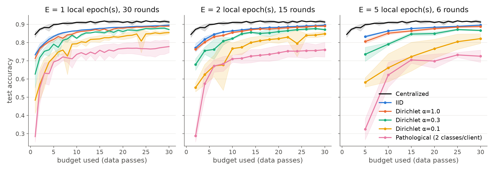

# FedAvg vs Centralized CNN Training

An implementation of **Federated Averaging (FedAvg)** compared against **centralized training** of the same CNN on Fashion-MNIST, with an equal training budget. It asks three questions:
- When does federated learning approach centralized performance?
- How does data heterogeneity affect convergence?
- What privacy claims can and cannot be made when data stay on the clients?

This is Question 2 of Assignment 3 for *Responsible AI for Foundation Models (DSE428/DSE628)*, IISER Bhopal.
The report covering all three questions is in [`docs/`](docs): [short version, 4 pages](docs/Assignment3_Short_Report.pdf) and [full report](docs/Assignment3_Report.pdf).

## Setup

- **Dataset:** Fashion-MNIST, 60k training images and one common held-out test set of 10k, with identical preprocessing everywhere.
- **Model:** one fixed small CNN (2 conv + 2 FC layers, 421,642 parameters, no BatchNorm) used in every experiment.
- **Clients:** 10 simulated clients, all participating every round.
  - **Aggregation:** sample-size-weighted averaging, w = Σ (n_k / n) · w_k.
- **Baseline:** centralized SGD on the union of the same examples, with the same model, initialisation, optimiser (SGD lr 0.05, batch 64) and preprocessing.
- **Equal budget:** 30 passes over the data for every run, with FedAvg rounds R = 30 / E for E ∈ {1, 2, 5} local epochs.
- **Data heterogeneity:**
  - IID.
  - Dirichlet label skew, α ∈ {1.0, 0.3, 0.1}.
  - Pathological: exactly 2 classes per client.
  - Every configuration was run with 3 seeds, 48 runs in total.
- **Privacy probe:** an honest-but-curious server infers each client's label mix from a single model update.

## How to run

```bash
pip install -r requirements.txt
python fedavg_vs_centralized.py run            # all 48 runs + privacy probe + figures (resumable)
python fedavg_vs_centralized.py run --quick    # smoke test (writes to results_quick/)
python fedavg_vs_centralized.py plot           # figures only
```

## Results (test accuracy after 30 passes, mean ± sd over 3 seeds)

| Data split | E = 1 | E = 2 | E = 5 | Gap to centralized |
|---|---|---|---|---|
| **Centralized** | **91.3 ± 0.8** | | | – |
| IID | 89.6 ± 0.1 | 89.6 ± 0.1 | 89.6 ± 0.1 | 1.7 pp |
| Dirichlet α = 1.0 | 89.0 ± 0.3 | 89.1 ± 0.3 | 88.8 ± 0.4 | 2.2–2.5 pp |
| Dirichlet α = 0.3 | 87.2 ± 0.4 | 87.1 ± 0.4 | 86.7 ± 0.4 | 4.1–4.6 pp |
| Dirichlet α = 0.1 | 85.5 ± 0.8 | 84.9 ± 1.3 | 82.2 ± 2.7 | 5.8–9.1 pp |
| Pathological (2 classes/client) | 77.8 ± 3.4 | 76.1 ± 4.0 | 72.5 ± 3.4 | 13.5–18.8 pp |



- **When FL comes close:** with IID or mildly skewed data FedAvg is within about 2 pp of centralized. E = 5 needs 5× less communication (202 vs 1,012 MB) at the same accuracy.
- **Heterogeneity slows and destabilises convergence.**
  - More local epochs help under IID data but **hurt under skew**, because each client drifts towards its own classes before averaging.
  - Under strong skew, 85% accuracy is reached late or never.
- **Privacy:** raw images stay on the clients, but **that is not privacy.** From one update, the server identifies which classes a client holds via the output-layer bias change (class-presence AUC 0.94–1.0 on non-IID data). FedAvg alone gives no formal guarantee.

Files:
- `results/training_logs.csv`: every round of every run.
- `results/summary.csv`: the results table.
- `results/privacy_*.csv`: the privacy probe results.
- `results/figures/`: the plots.

## AI use

All code was generated with **Claude Opus 5.5** (Anthropic, `claude-opus-5-5`) through Claude Code, following my prompts. The complete, verbatim prompt log is in Appendix A of the [full report](docs/Assignment3_Report.pdf).
